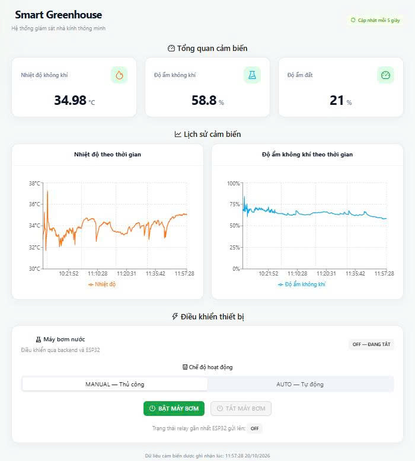
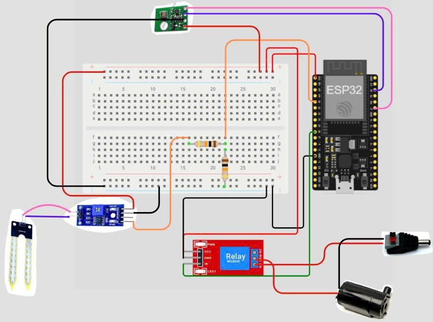
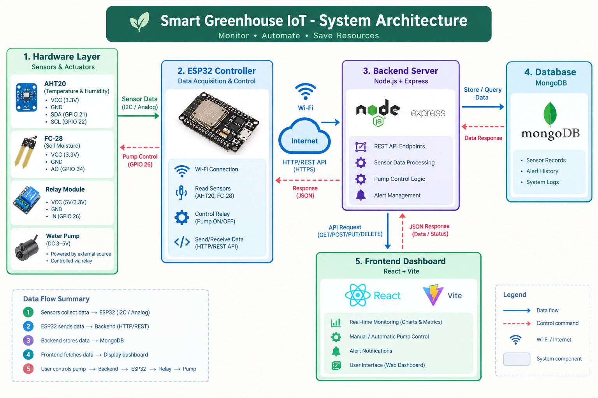

# 🌱 Smart Greenhouse IoT System

An IoT-based smart greenhouse monitoring and irrigation system built with ESP32, environmental sensors, a Node.js/Express REST API, MongoDB, and a React web dashboard.

The system collects environmental data, monitors soil moisture, manages water pump operation, and records sensor measurements and alerts for greenhouse monitoring.

## 📸 Project Preview

### Web Dashboard



### Hardware Circuit



### System Architecture



## ✨ Key Features

- **Environmental Monitoring:** Collects temperature and air humidity using the AHT20 sensor.
- **Soil Moisture Monitoring:** Reads analog measurements from the FC-28 soil moisture sensor.
- **Automated Irrigation:** Controls a mini water pump through a relay based on the irrigation logic implemented in the ESP32 firmware.
- **Manual Pump Control:** Supports manual pump operation through the system's control interface and API.
- **Sensor Data Storage:** Stores sensor readings in MongoDB for subsequent retrieval.
- **Alert Management:** Tracks conditions such as low soil moisture and invalid sensor readings, with active and resolved alert states.
- **Web-Based Monitoring:** Provides a React dashboard for viewing greenhouse information and system status.
- **REST API:** Connects the web application, backend services, and IoT system.

## 🏗️ System Architecture

The project consists of four main layers:

1. **Hardware Layer:** AHT20 temperature and humidity sensor, FC-28 soil moisture sensor, relay module, and DC water pump.
2. **Embedded Layer:** ESP32 reads sensor data, connects to Wi-Fi, communicates with the backend, and controls the irrigation hardware.
3. **Backend Layer:** Node.js and Express provide REST API endpoints, process sensor submissions, manage pump operations, and synchronize alerts.
4. **Data and Presentation Layer:** MongoDB stores sensor records and alerts, while the React dashboard provides a web interface.

The ESP32 communicates with the backend over HTTP on the local network. The exact pump-command communication flow depends on the firmware and backend implementation.

## 🧰 Technologies Used

| Component            | Technologies                            |
| -------------------- | --------------------------------------- |
| Microcontroller      | ESP32                                   |
| Firmware             | Arduino IDE, C++                        |
| Environmental Sensor | AHT20                                   |
| Soil Moisture Sensor | FC-28                                   |
| Actuator             | Relay module, DC mini water pump        |
| Backend              | Node.js, Express.js                     |
| Database             | MongoDB, Mongoose                       |
| Frontend             | React, Vite, JavaScript                 |
| Development Tools    | Visual Studio Code, Git, GitHub, Docker |

## 📁 Project Structure

```text
Smart-Greenhouse-IOT-software/
├── backend/
│   ├── src/
│   │   ├── config/
│   │   ├── controllers/
│   │   ├── models/
│   │   ├── routes/
│   │   ├── services/
│   │   └── server.js
│   ├── package.json
│   └── package-lock.json
├── frontend/
│   ├── public/
│   ├── src/
│   ├── package.json
│   └── vite.config.js
├── esp32/
│   └── SmartGreenhouse/
│       └── SmartGreenhouse.ino
├── docs/
│   └── images/
│       ├── dashboard.png
│       ├── hardware-circuit.png
│       └── system-architecture.png
├── .gitignore
└── README.md
```

## 🔌 Hardware Connections

| Device    | ESP32 Pin | Purpose                    |
| --------- | --------- | -------------------------- |
| AHT20 SDA | GPIO 21   | I²C data                   |
| AHT20 SCL | GPIO 22   | I²C clock                  |
| FC-28 AO  | GPIO 34   | Analog soil moisture input |
| Relay IN  | GPIO 26   | Water pump control         |

The AHT20, soil moisture sensor, and relay module also require appropriate power and ground connections. Check the specific module's voltage requirements before wiring.

The water pump is powered by a suitable external DC supply and switched through the relay contacts. Do not power the pump directly from an ESP32 GPIO pin.

## ⚙️ Getting Started

### Prerequisites

Install the following tools before running the project:

- Node.js and npm
- MongoDB, either locally or through Docker
- Arduino IDE
- ESP32 board support for Arduino IDE
- Required sensor libraries for the firmware
- Git

### 1. Clone the Repository

```bash
git clone https://github.com/duynguyen1312004/Smart-Greenhouse-IOT-software.git
cd Smart-Greenhouse-IOT-software
```

### 2. Configure MongoDB

Start a MongoDB instance that the backend can access.

If using Docker, ensure the container is running and that its published port matches the database connection configuration.

### 3. Configure the Backend

```bash
cd backend
npm install
```

Create a local `.env` file using the environment variable names expected by the backend configuration. Configure the server port and MongoDB connection string as required by the source code.

Do not commit `.env` or publish database credentials.

Start the backend using the development script defined in `backend/package.json`. In the current development setup, the API runs at:

```text
http://localhost:5000
```

### 4. Configure the Frontend

Open a second terminal:

```bash
cd frontend
npm install
npm run dev
```

Vite normally serves the development application at:

```text
http://localhost:5173
```

Ensure the frontend's API configuration points to the running backend.

### 5. Configure the ESP32

1. Open `esp32/SmartGreenhouse/SmartGreenhouse.ino` in Arduino IDE.
2. Install the libraries required by the sketch.
3. Configure your Wi-Fi SSID and password locally.
4. Update the backend IP address and API URLs to match your development computer and network.
5. Select the correct ESP32 board and serial port.
6. Upload the firmware and monitor its output using the Serial Monitor.

The ESP32 and backend must be able to communicate over the network. The address `localhost` on the ESP32 would refer to the ESP32 itself, not the development computer; use the computer's reachable local IP address when required.

## 🔗 REST API

The backend exposes endpoints for health checks, sensor data, pump operations, and alert management.

| Method | Endpoint                      | Purpose                                     |
| ------ | ----------------------------- | ------------------------------------------- |
| GET    | `/api/health`                 | Check backend health                        |
| POST   | `/api/sensors`                | Submit sensor data                          |
| GET    | `/api/sensors`                | Retrieve sensor records                     |
| GET    | `/api/sensors/latest`         | Retrieve the latest sensor reading          |
| GET    | `/api/pump`                   | Retrieve pump status or control information |
| POST   | `/api/pump`                   | Submit a pump-control request               |
| GET    | `/api/alerts`                 | Retrieve alerts                             |
| GET    | `/api/alerts?status=ACTIVE`   | Retrieve active alerts                      |
| GET    | `/api/alerts?status=RESOLVED` | Retrieve resolved alerts                    |

API behavior and request payloads are defined by the backend implementation.

## 🛡️ Alert Management

The backend includes alert handling for conditions such as:

- **Low Soil Moisture:** An alert is raised when soil moisture reaches the configured low-moisture threshold.
- **Invalid Sensor Data:** An alert can be generated when sensor readings are invalid.
- **Alert Lifecycle:** Active alerts can be resolved when the relevant condition no longer applies.

The current low-moisture logic uses a threshold of 30% to activate the alert and a threshold above 35% to resolve it. These values are software settings and may need calibration for different soil types and sensor installations.

## 🚀 Future Improvements

- Add a secure remote-access option for monitoring outside the local network.
- Improve sensor calibration and measurement reliability.
- Add historical charts and trend analysis to the dashboard.
- Introduce configurable irrigation thresholds and schedules.
- Improve firmware configuration management and device communication security.
- Expand the system with additional environmental sensors.

## 👨‍💻 Author

**Nguyen Huu Duy**

Student, University of Science, Vietnam National University Ho Chi Minh City (VNU-HCM).

Project focus: IoT, embedded systems, sensor integration, backend development, and automated irrigation.

## 📄 License

No license has been specified yet. Contact the author before reusing or redistributing this project.
